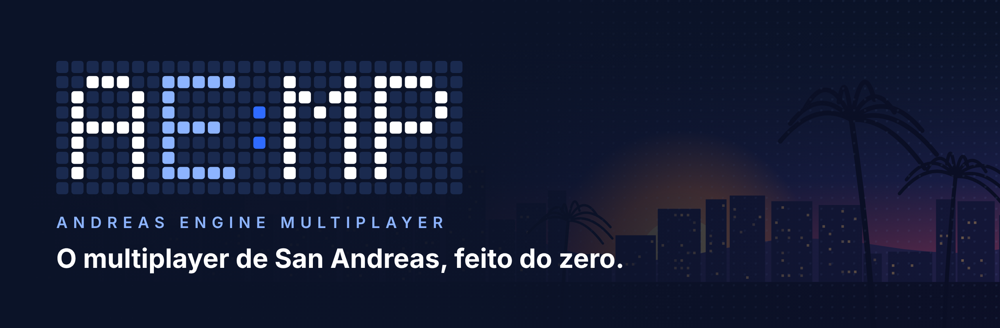
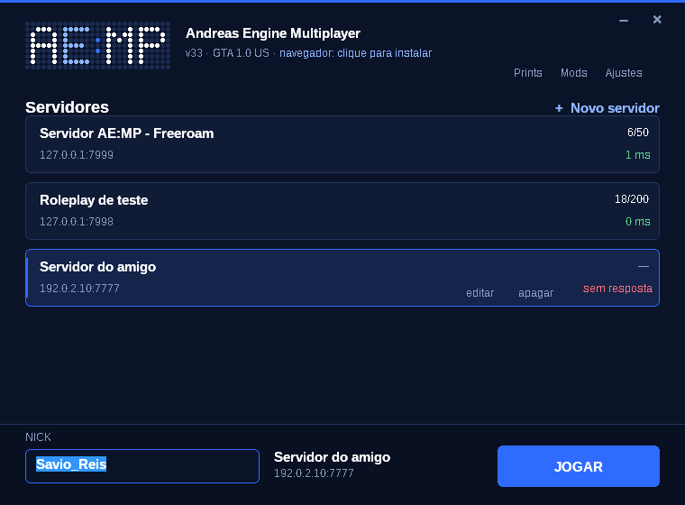
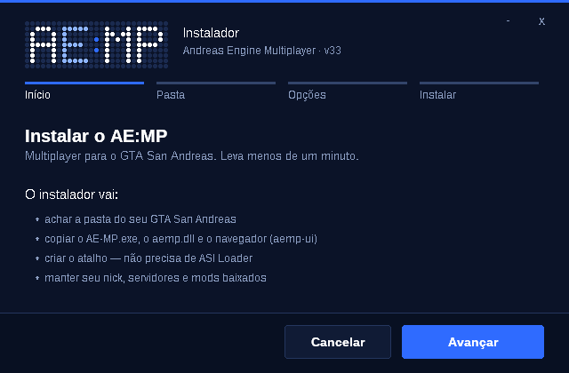
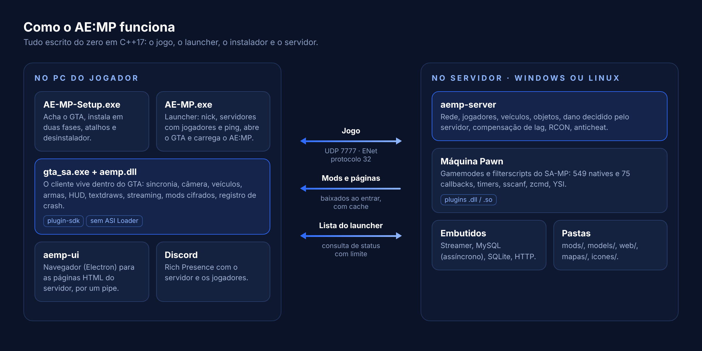
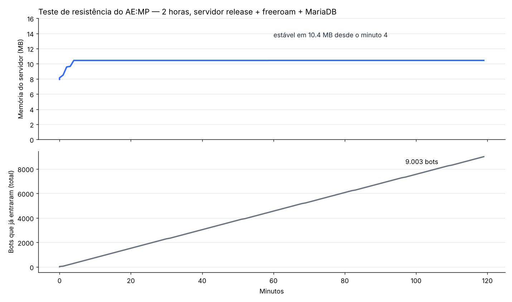

  

  
  
  
  
  
  

  <b>Um multiplayer para GTA San Andreas escrito do zero, compatível com os gamemodes em Pawn do SA-MP e com recursos que o SA-MP nunca teve.</b>

  <a href="https://aemp.pages.dev"><b>🌐 Site e documentação</b></a> &nbsp;·&nbsp;
  <a href="https://github.com/SavioReis/AE-MP/releases/latest"><b>📥 Downloads</b></a> &nbsp;·&nbsp;
  <a href="#-como-o-ae-mp-funciona"><b>⚙️ Como funciona</b></a> &nbsp;·&nbsp;
  <a href="#-qualidade-e-testes"><b>🧪 Testes</b></a>

---

## 💡 Por que o AE:MP existe

Comecei o AE:MP em **2024** com uma ideia simples: ter o meu próprio multiplayer de San Andreas, do jeito que eu acho que um servidor deveria funcionar hoje.

O SA-MP marcou uma geração, mas parou no tempo. Quem tem servidor conhece os limites: interface presa ao GTA, mods que cada jogador precisa instalar na mão, trapaças que mexem em vida e dinheiro. Em vez de remendar o que já existia, ou partir do MTA, decidi escrever tudo do zero, com uma regra que nunca mudou:

> **O gamemode em Pawn que você já tem precisa continuar funcionando.**

Foram muitas etapas, uma de cada vez, testando cada parte antes de seguir. Em novembro de 2026 saiu a **versão 1.0.0**, a primeira com número de versão de verdade.

---

## ✨ Destaques

<table>
<tr>
<td width="50%" valign="top">

### 🔁 Compatível com o SA-MP
**571 natives** e **76 callbacks** com os mesmos nomes, MySQL no estilo R39 e R41 sem plugin, e as teclas do SA-MP (F, Y, N, H). `a_samp`, `sscanf`, `zcmd` e YSI funcionam, e plugins do SA-MP (`.dll` e `.so`) carregam pela pasta `plugins/`.

</td>
<td width="50%" valign="top">

### 🌐 Páginas HTML no jogo
Login, HUD, lojas, menus e telões em **HTML, CSS e JavaScript**, conversando com o gamemode. Páginas também aparecem em objetos do mapa, com áudio.

</td>
</tr>
<tr>
<td valign="top">

### 📦 Mods baixados do servidor
Carros, skins e armas na pasta `mods/`: o jogador baixa **antes de entrar**, com cache e cifrados. Objetos e skins **novos** com `AddSimpleModel` e `AddCharModel`.

</td>
<td valign="top">

### 🛡️ Jogo justo
**Dano decidido pelo servidor**: arma, alcance e cadência conferidos. Vida, colete e dinheiro não sobem pelo jogador. **Compensação de lag** nos tiros.

</td>
</tr>
<tr>
<td valign="top">

### 🗄️ Tudo embutido
**Streamer**, **MySQL** (assíncrono, sem plugin), **SQLite** e **HTTP** já vêm no servidor.

</td>
<td valign="top">

### 🚀 Recursos novos
**Teclas livres**, **GPS pelas ruas**, portas e entradas, **ícones próprios** no mapa, velocímetro, oficinas e tuning, textdraws com modelo 3D e **Discord** no perfil do jogador.

</td>
</tr>
</table>

> O AE:MP **não configura nada do mundo sozinho**. Oficinas, portas, teclas, ícones e menus só existem quando o gamemode cria, então um servidor de RP não recebe coisas que não pediu.

---

## 🖥️ Launcher e instalador

  
  

- **AE-MP-Setup.exe** acha a pasta do GTA sozinho (instalação anterior, bibliotecas da Steam e pastas comuns), instala **em duas fases** (nada fica pela metade), cria os atalhos e aparece em "Adicionar ou remover programas".
- **AE-MP.exe** mostra **jogadores e ping** de cada servidor salvo, confere a versão do GTA e abre o jogo **sem ASI Loader**: ele carrega o `aemp.dll` dentro do GTA antes do jogo começar.
- O logo em **painel de LED** é desenhado pelo próprio programa, ponto por ponto, sem imagem.

*Capturas reais dos programas, rodando numa máquina de teste.*

---

## ⚙️ Como o AE:MP funciona

  

| Parte | O que faz | Linhas de código |
|---|---|---:|
| **Cliente** (`aemp.dll`) | Vive dentro do GTA: sincronia, veículos, armas, câmera, HUD, textdraws, streaming, mods, crash | ~31.700 |
| **Servidor** (`aemp-server`) | Rede, máquina Pawn, natives, dano, RCON, mods, MySQL, consulta de status | ~15.700 |
| **Compartilhado** | Protocolo, criptografia, nomes de veículos | ~3.200 |
| **Launcher e instalador** | Interface Win32 desenhada à mão, injeção do cliente, pacote com SHA-256 | ~2.400 |
| **Navegador** (`aemp-ui`) | Electron com protocolo `aemp://` e política de endereços | ~1.500 |
| **Gamemode freeroam e includes** | Exemplo completo em Pawn, `aemp.inc` e compatibilidade com `a_samp` | ~5.100 |
| **Bot de testes e suíte** | Bot que joga sozinho e os testes automáticos | ~6.200 |
| **Total** | | **~66.000** |

**Tecnologias:** C++17 (clang e MinGW para Windows, GCC para Linux), ENet (rede UDP), Pawn (máquina virtual dos scripts), plugin-sdk (acesso ao GTA), SQLite, stb_image e Electron.

---

## 🧪 Qualidade e testes

Cada versão só sai depois de passar por tudo isto:

| Teste | O que confere | Resultado na 1.0.0 |
|---|---|---|
| **Suíte automática** | 452 verificações em mais de 50 áreas: streaming, veículos, armas e dano, textdraws, objetos, mods, navegador, toda a API do SA-MP, MySQL, Discord, teclas, logs, launcher e instalador | ✅ 452 de 452 |
| **Suíte com MariaDB** | A mesma suíte com um banco de verdade, para o MySQL embutido (R39 e R41) | ✅ 461 de 461 |
| **Memória** | Todos os servidores compilados com AddressSanitizer e UBSan | ✅ 0 erros |
| **Carga** | 30 rodadas de 60 jogadores entrando e saindo + 50 de uma vez, com um "vigia" conferindo a lista de jogadores | ✅ 168 de 168 |
| **Pacotes corrompidos** | Fuzz: pacotes aleatórios e malformados não derrubam o servidor | ✅ |
| **Jogo no Windows** | O código do cliente rodando no Wine: pipe do navegador, medição por quadro, injeção, instalação e desinstalação | ✅ |

### Teste de resistência: 2 horas

Servidor de produção com o freeroam e MariaDB, recebendo bots sem parar durante 2 horas: **9.003 entradas, 0 erros, e a memória estável em 10,4 MB do minuto 4 até o fim**. Sem vazamento.

  

---

## 🗺️ O caminho até aqui

| Etapa | O que entrou |
|---|---|
| **2024: o começo** | A base do multiplayer: conexão, sincronia de jogadores e o protocolo próprio |
| **O mundo** | **Streaming em camadas**, mundos virtuais, interiores, veículos, armas, dano e morte, ícones, hora e clima |
| **A interface** | Janelas, gametexts, textos 3D, **textdraws** clicáveis, placar e seleção de classe |
| **Objetos** | Objetos, pickups, checkpoints, gangzones, **streamer embutido**, mapas e editor de objetos |
| **Administração** | **RCON** dentro do jogo, plugins do SA-MP e filterscripts |
| **Mods** | **Mods baixados do servidor**, com cache cifrado, e modelos novos |
| **Navegador** | **Páginas HTML no jogo**, telões e áudio |
| **API do SA-MP** | PVars, SVars, SQLite, HTTP, câmera, espectador, animações, atores, tuning, veículos completos |
| **v28** | Textdraws com modelo 3D e regras do servidor |
| **v29** | Entrar mais rápido: os mods só são conferidos de novo quando mudam |
| **v30** | **GPS** pelas ruas, **MySQL embutido** e compensação de lag nos tiros |
| **v31** | **Discord** no perfil do jogador |
| **v32** | **Teclas livres** escolhidas pelo gamemode |
| **v33** | **Instalador próprio**, launcher novo e **fim do ASI Loader** |
| **1.0.0 · nov/2026** | Primeira versão numerada: **logs organizados** em colunas e com cor, **MySQL R41**, teclas do SA-MP (F, Y, N, H) e gamemodes RP do SA-MP rodando sem adaptação |

A lista completa de cada versão está em [Novidades por versão](https://aemp.pages.dev/#changelog).

---

## 🧭 Decisões de projeto

- **O servidor decide.** Dano, vida, colete e dinheiro são do servidor; o jogo só mostra.
- **Nada aparece sozinho.** O motor não cria oficinas, portas, teclas ou menus: só o gamemode.
- **Sem peso morto.** Menus antigos do GTA (`CreateMenu`), NPCs que ocupam vaga e `SendClientCheck` **não existem** no AE:MP, nem como função vazia. O compilador avisa, e o gamemode usa as alternativas modernas (diálogos, páginas HTML).
- **Anticheat próprio**, começando pelo dano decidido no servidor, sem depender de ferramentas de terceiros.
- **Nenhum arquivo do GTA.** O AE:MP não distribui nada da Rockstar: cada jogador usa a própria cópia do jogo.

---

## 📥 Para jogar ou criar um servidor

| | |
|---|---|
| **Jogar** | Baixe o **[AE-MP-Setup.exe](https://github.com/SavioReis/AE-MP/releases/latest/download/AE-MP-Setup.exe)**, rode e abra pelo atalho **AE:MP**. Precisa do GTA San Andreas 1.0 para PC. |
| **Servidor** | Baixe o pacote para **[Windows](https://github.com/SavioReis/AE-MP/releases/latest/download/AE-MP-servidor-windows.zip)** ou **[Linux](https://github.com/SavioReis/AE-MP/releases/latest/download/AE-MP-servidor-linux.tar.gz)**, mude o `hostname` no `server.cfg` e inicie. Libere a porta **7777 UDP**. |
| **Documentação** | Guias, todas as natives e callbacks com exemplo: **[aemp.pages.dev](https://aemp.pages.dev)** |

---

## 👤 Autor

Feito por **Sávio Reis**, desde 2024.

---

AE:MP (Andreas Engine Multiplayer), o nome, a logo e o código são © 2024–2026 Sávio Reis. Todos os direitos reservados. 
Grand Theft Auto e San Andreas são marcas da Rockstar Games e da Take-Two Interactive. O AE:MP é um projeto independente, feito por fã, não é afiliado à Rockstar, à Take-Two, à equipe do SA-MP nem ao open.mp, e não inclui arquivos do GTA. 
Usa ENet (MIT), Pawn (zlib), plugin-sdk (zlib), SQLite (domínio público), stb_image (domínio público/MIT) e Electron (MIT).

